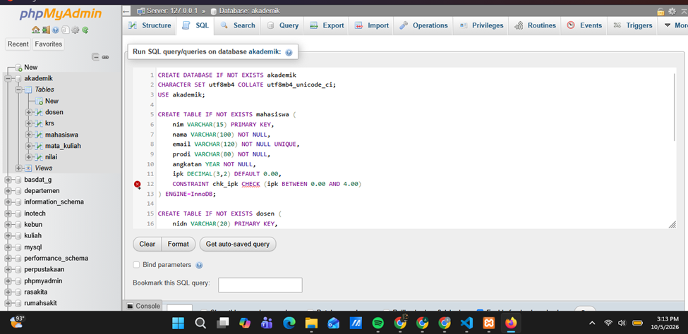
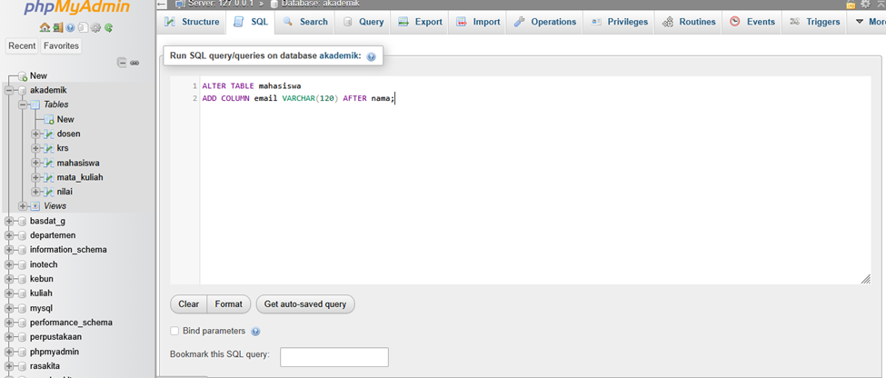
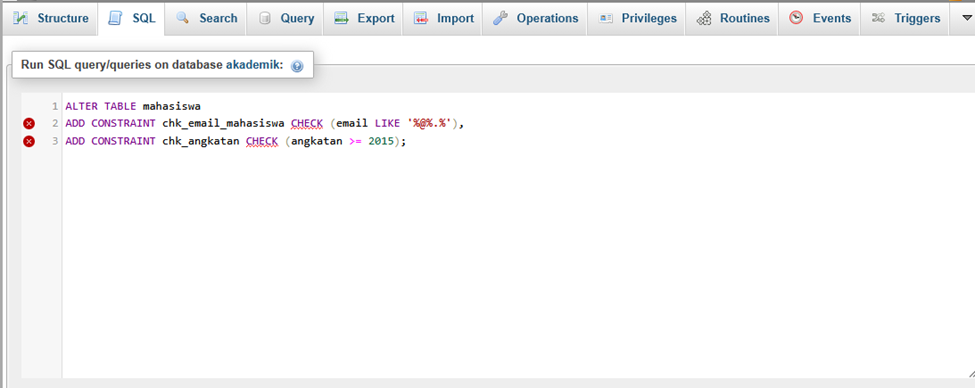
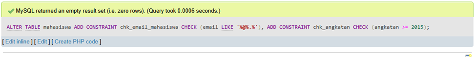
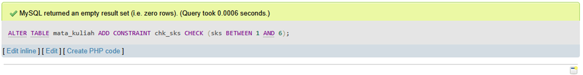
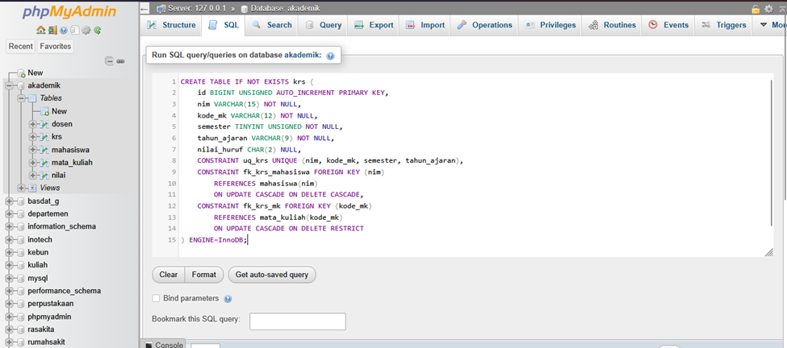
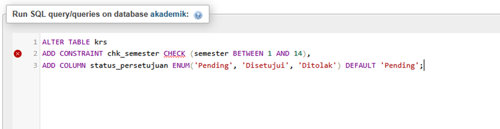

# Laporan Tugas Praktikum Pertemuan 3: Database Akademik

Tugas ini mempraktikkan kueri DDL (*Data Definition Language*) dan DML (*Data Manipulation Language*) pada database `akademik` menggunakan MySQL/MariaDB melalui phpMyAdmin. Berkas SQL hasil modifikasi tersedia di [`akademik_one_modifikasi_.sql`](./akademik_one_modifikasi_.sql).

## 1. Eksekusi Program

Database akademik menggunakan tabel `mahasiswa`, `dosen`, `mata_kuliah`, dan `krs`. Skrip SQL mendefinisikan kolom, kunci utama, indeks unik, serta relasi foreign key untuk menjaga integritas data.

## 2. Modifikasi Bermakna

1. **Validasi data mahasiswa dan mata kuliah:** menambahkan kolom email mahasiswa serta constraint untuk format email, tahun angkatan, dan rentang SKS.
2. **Validasi pengambilan mata kuliah:** membatasi semester KRS pada rentang 1–14 dan menambahkan `status_persetujuan` dengan pilihan `Pending`, `Disetujui`, atau `Ditolak`.

## 3. Lima Bagian Kode Penting

1. **Primary key** — `nim` menjadi identitas unik mahasiswa.
2. **Foreign key** — relasi `krs` ke `mahasiswa` dan `mata_kuliah` menjaga agar KRS hanya merujuk data yang tersedia.
3. **Check constraint** — `chk_sks` membatasi jumlah SKS pada rentang 1 sampai 6.
4. **Unique constraint** — `uq_krs` mencegah mahasiswa mengambil mata kuliah yang sama dua kali pada semester dan tahun ajaran yang sama.
5. **Default value** — status KRS otomatis bernilai `Pending` jika tidak ditentukan saat data dimasukkan.

## 4. Screenshot Sebelum dan Sesudah Modifikasi

### Modifikasi 1: Kolom email dan validasi mahasiswa/mata kuliah

**Sebelum**

**Sesudah**

### Modifikasi 2: Status persetujuan dan validasi semester KRS

**Sebelum**

**Sesudah**

## 5. Error, Penyebab, dan Perbaikan

**Pesan error:** `#1050 - Table 'krs' already exists`.

**Penyebab:** tabel `krs` sudah ada di database sehingga perintah pembuatan tabel dengan nama yang sama ditolak.

**Perbaikan:** gunakan `CREATE TABLE IF NOT EXISTS krs` agar kueri aman dijalankan ulang. Jika perlu membuat ulang tabel, hapus tabel lama terlebih dahulu dengan `DROP TABLE IF EXISTS krs`.
